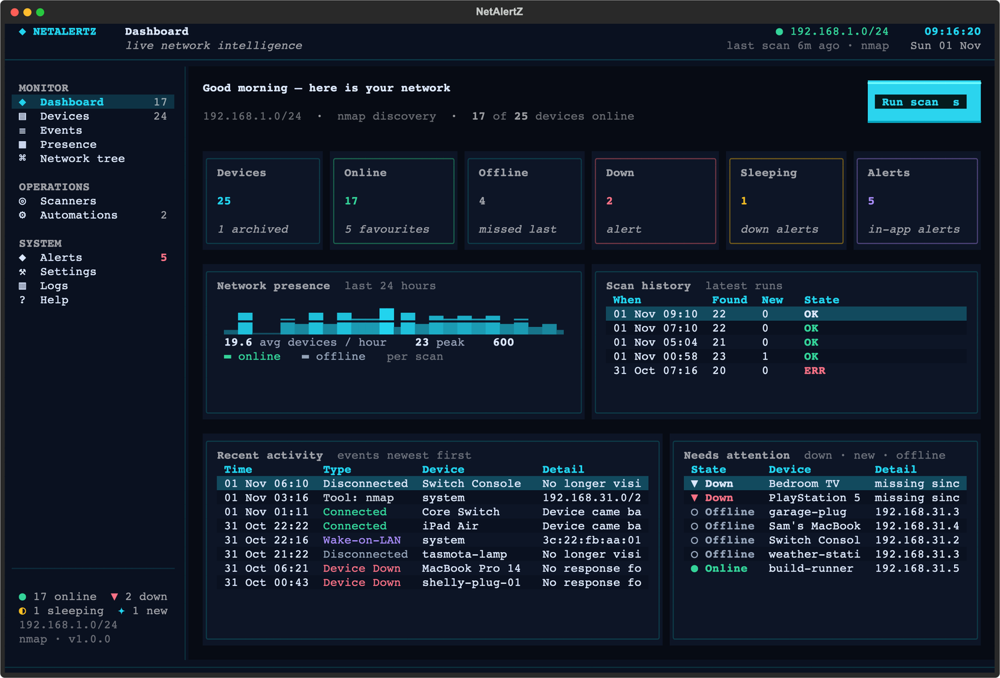
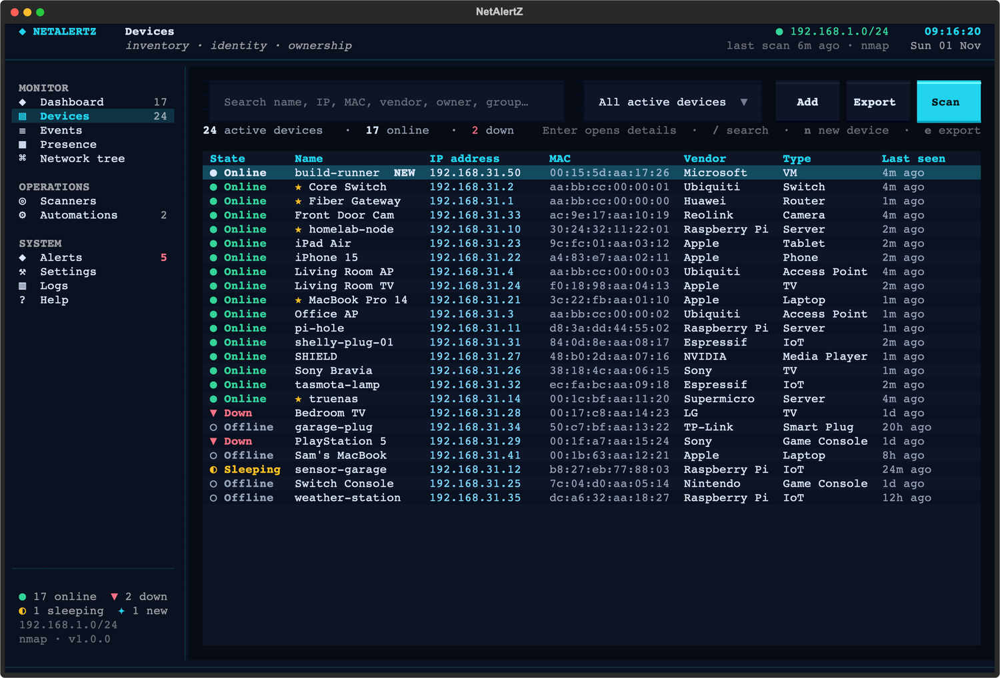
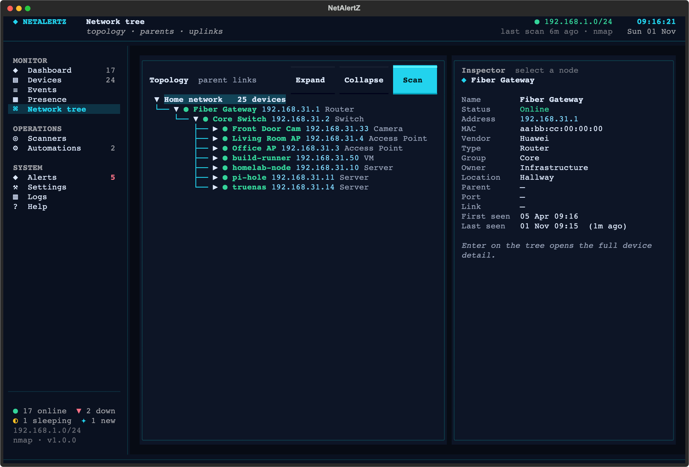

# NetAlertZ

**Network intelligence in your terminal.** NetAlertZ is a terminal-native
network discovery, inventory, presence and alerting app inspired by NetAlertX —
rebuilt as a single Python application with a fully custom TUI.

No Docker. No daemon. No web server. Just Python and your terminal.



| Devices | Network tree |
| --- | --- |
|  |  |

## Why NetAlertZ

NetAlertX is great, but it expects a browser and a container stack. NetAlertZ
keeps the useful parts — discovery, device history, presence, alerts, topology
and automation — and runs directly on the machine that is doing the scanning.

- **One process** — `python -m netalertz` starts everything.
- **One data file** — everything is stored in a local SQLite database.
- **No services** — no Docker, systemd unit, reverse proxy or web UI required.
- **Terminal first** — keyboard-driven, fast, and comfortable over SSH.

## Features

| Area | What you get |
| --- | --- |
| **Dashboard** | Live device KPIs, 24-hour presence sparkline, scan history, recent events, devices needing attention. |
| **Devices** | Searchable inventory with status filters, owners, groups, locations, favourites, tags, archive and CSV import/export. |
| **Device detail** | Overview, activity, presence sparkline, connection sessions and built-in diagnostics (ping, nmap, traceroute). |
| **Events** | Filterable event stream: new devices, connections, disconnects, down/online transitions, scans, tool runs and more. |
| **Presence** | Hourly heatmap and uptime percentages per device, with partial/offline/sleeping states. |
| **Network tree** | Parent/child topology built from device relationships and parent ports. |
| **Scanners** | Backend health, active discovery method, targets, schedule, scan history and per-scan diagnostics. |
| **Automations** | Rule engine with triggers, conditions and field actions for automatic enrichment. |
| **Alerts** | In-app notification inbox with read state; optional webhook and Telegram delivery. |
| **Settings** | Edit every setting in the TUI, reset defaults, import/export CSV, inspect storage paths. |
| **Logs** | Live application log with level filters. |
| **Help** | Built-in keyboard map, concepts and command reference. |

Other details:

- Four themes (`netalertz`, `ember`, `nord`, `mono`) — cycle with `F2`.
- Wake-on-LAN for known devices.
- Demo dataset for exploring the UI without touching the network.
- Scheduled background scans with a configurable interval.
- Down detection with a configurable threshold and sleepy-device handling.
- Optional hostname resolution and offline OUI vendor lookup.
- No telemetry; nothing leaves the machine unless you configure a webhook or
  Telegram bot.

## Requirements

- Python **3.10+**
- macOS or Linux
- At least one discovery tool is recommended:
  - [`nmap`](https://nmap.org/) — portable host discovery (recommended)
  - [`arp-scan`](https://github.com/royhills/arp-scan) — best signal quality on a LAN
  - `fping` — fast ping sweeps
  - The OS ARP/neighbour cache is always used as a fallback

`arp-scan` and some `nmap` modes need root privileges. NetAlertZ never runs
`sudo` for you; without elevated privileges discovery still works, but MAC
addresses and vendor enrichment may be limited on some platforms.

## Quick start

```bash
cd NetAlertZ
./run.sh
```

`run.sh` creates `.venv`, installs the pinned dependency, and launches the app.
Everything after that is inside the TUI: press `s` to scan, `?` for help,
`F2` to change theme, and `Ctrl+Q` to quit.

Explore the interface without scanning your network:

```bash
./run.sh --demo
```

## Manual installation

```bash
python3 -m venv .venv
source .venv/bin/activate
pip install -r requirements.txt
python -m netalertz
```

Or install it as a normal command:

```bash
pip install -e .
netalertz
```

## Command line

```text
netalertz [options]

  --db PATH          use a specific SQLite database file
  --demo             seed a realistic demo network when the database is empty
  --reset-demo       wipe the database and reload the demo dataset (destructive)
  --scan             run a discovery scan immediately after launch
  --no-scan          disable automatic and scheduled scanning for this session
  --interval SECONDS override the scheduled scan interval (minimum 15)
  --version          print the version
  -h, --help         show help
```

Examples:

```bash
netalertz --demo                 # explore a populated fake network
netalertz --scan                 # start scanning right away
netalertz --no-scan              # open in read-only/quiet mode
netalertz --db ./lab.db          # keep a separate lab inventory
netalertz --interval 300         # scan every five minutes
```

## Keyboard

| Key | Action |
| --- | --- |
| `1`–`9` | Jump to Dashboard, Devices, Events, Presence, Network, Scanners, Automations, Alerts, Settings |
| `l` / `h` / `?` | Logs / Help |
| `s` | Run a discovery scan |
| `r` | Refresh the current view |
| `/` | Focus search |
| `Enter` | Open the selected row |
| `n` | New device or automation (context sensitive) |
| `e` | Export devices to CSV (Devices view) / edit (device detail) |
| `d` | Delete the selected event, notification or automation |
| `w` / `a` / `f` | Wake / archive / favourite a device (detail view) |
| `Esc` | Close a dialog without saving |
| `F2` | Cycle themes |
| `Ctrl+Q` | Quit |

## How discovery works

NetAlertZ tries the best available backend and degrades gracefully:

```text
arp-scan  →  nmap  →  fping  →  OS ARP cache
```

1. **Plan targets** — use `Settings → Scanning → Scan targets`, or auto-detect
   the most likely physical LAN interface (VPN and virtual interfaces are
   de-prioritised).
2. **Discover hosts** — run the configured backend and merge anything already
   present in the OS neighbour cache.
3. **Identify** — normalise MAC addresses, look up vendors from a bundled OUI
   table, resolve hostnames when enabled, and infer a device type.
4. **Ingest** — update existing devices by MAC (or by IP when no MAC is
   available), create new ones, and mark missing devices offline/down.
5. **Record history** — write scan results, events and hourly presence samples.
6. **Automate** — apply matching automation rules and send configured alerts.

## Data and configuration

All state lives in `~/.netalertz` by default:

| Path | Contents |
| --- | --- |
| `~/.netalertz/netalertz.db` | SQLite database (devices, events, scans, presence, settings, rules, notifications) |
| `~/.netalertz/netalertz.log` | Rotating application log |
| `~/.netalertz/exports/` | CSV exports created from the UI |

Override the location for testing or multiple inventories:

```bash
NETALERTZ_HOME=/tmp/netalertz-lab ./run.sh
```

Back up the app by copying `netalertz.db`. There is no external service to
export or restore.

## Demo mode

`--demo` seeds a realistic 25-device network (gateway, switches, access points,
phones, laptops, servers, IoT, cameras, consoles, offline and archived devices)
with events, presence history, sessions, automations and notifications.

```bash
./run.sh --demo            # seed only when the database is empty
./run.sh --reset-demo      # wipe and reseed (destructive)
```

Demo mode disables automatic scanning by default so it does not generate
surprise network traffic. Add `--scan` if you want to scan as well.

## Project layout

```text
netalertz/
├── cli.py              # argparse entry point
├── config.py           # paths, defaults, setting metadata
├── db.py               # SQLite schema and queries
├── engine.py           # discovery pipeline, events, presence, alerts, tools
├── scanner.py          # arp-scan / nmap / fping / ARP-cache backends
├── notifications.py    # in-app, webhook and Telegram delivery
├── demo.py             # demo dataset
├── utils.py            # networking, formatting, subprocess helpers
└── tui/
    ├── app.py          # shell, navigation, workers, timers
    ├── theme.tcss      # all layout and styling
    ├── themes.py       # colour themes
    ├── detail.py       # device detail modal
    ├── modals.py       # forms and confirmations
    ├── widgets.py      # sidebar, top bar, cards, footer
    └── views/          # dashboard, devices, events, presence, network,
                        # scanners, automations, notifications, settings,
                        # logs, help
```

## Troubleshooting

**“No scan target”** — connect to a LAN or set `scan_subnets` manually in
Settings. A VPN-only connection has no LAN to discover.

**No hosts found** — verify the backend is installed (`nmap --version`,
`fping -v`, `arp-scan --version`). Try `nmap` first; it is the most portable.

**MAC addresses or vendors are missing** — non-root discovery may not expose
layer-2 information. Run an ARP-based scan with appropriate privileges, or
accept IP-keyed devices. Devices are still tracked and updated by IP.

**The UI looks cramped** — NetAlertZ adapts down to roughly 100×30. Below
110 columns the sidebar collapses to an icon rail, and narrow layouts hide
optional columns. Larger terminals show more detail; tables scroll horizontally
when a table is wider than the available space.

**Textual import errors** — use the project virtualenv (`.venv/bin/python`) or
run `./run.sh`, which installs the pinned Textual version.

**Reset everything** — stop the app and delete `~/.netalertz/netalertz.db`
(or use `--reset-demo` to restore the demo dataset).

## Development

```bash
python -m compileall netalertz
python -m netalertz --demo --no-scan
```

The codebase is split into core logic (`engine`, `scanner`, `db`, `config`) and
`netalertz/tui` presentation. Views subclass `BaseView` and
implement `refresh_data()`; the shell in `tui/app.py` handles navigation,
workers, periodic refresh and theming.
